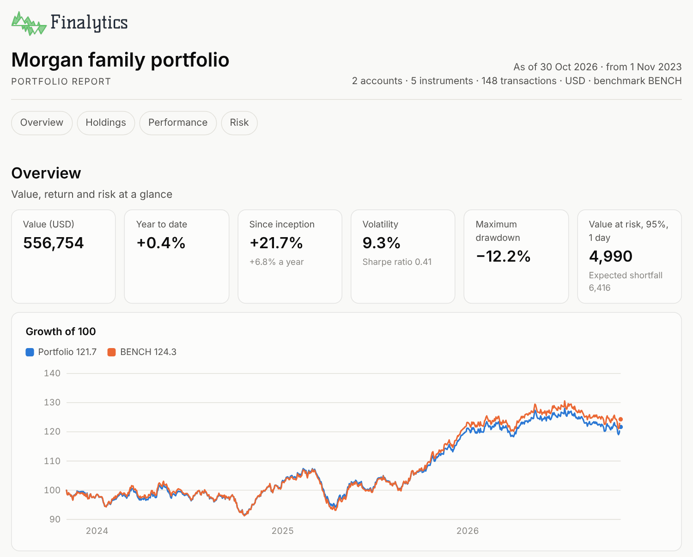

<picture>
  <source media="(prefers-color-scheme: dark)" srcset="https://raw.githubusercontent.com/sigmafieldlabs/finalytics/main/docs/assets/finalytics-logo-dark.png">
  
</picture>

[](https://github.com/sigmafieldlabs/finalytics/actions/workflows/ci.yml)
[](https://crates.io/crates/finalytics)
[](https://docs.rs/finalytics)
[](https://pypi.org/project/finalytics/)
[](https://www.npmjs.com/package/finalytics)
[](https://github.com/sigmafieldlabs/finalytics#licence)
[](https://www.rust-lang.org)
[](https://sigmafield.app/libraries/finalytics)

Finalytics is a portfolio analytics engine written in Rust, with bindings for
Python and for JavaScript and TypeScript through WebAssembly. It keeps the books
of a multi-currency portfolio from its transactions, measures performance and
risk, explains returns against a benchmark, and optimises portfolios under
real-world constraints.

> **Status:** Finalytics 1.0 is in active development. It is a redesign of the
> 0.x series; the 0.9 release remains available on the `0.9.x` branch, and the
> [migration guide](https://github.com/sigmafieldlabs/finalytics/blob/main/docs/migrating-from-0.9.md)
> explains what replaces each part of it.

| Language | Package | Install |
| --- | --- | --- |
| Rust | [`finalytics`](https://crates.io/crates/finalytics) | `cargo add finalytics` |
| Python (3.10+) | [`finalytics`](https://pypi.org/project/finalytics/) | `pip install finalytics` |
| JavaScript / TypeScript | [`finalytics`](https://www.npmjs.com/package/finalytics) | `npm install finalytics` |

Until 1.0.0 is released, these commands install the 0.x series (0.9 on crates.io
and PyPI, 0.2 on npm). Install a 1.0 pre-release with
`cargo add finalytics@<version>`, `pip install --pre finalytics` or
`npm install finalytics@next`.

## A portfolio in four steps

Review a portfolio, find where its risk comes from, choose a better mix of the
same funds, and get the trades that reach it, in each account. The portfolio is
one of the datasets that come with the library: three years of a brokerage and a
retirement account, in dollars and euros.

```rust,no_run
//! Review a portfolio, find where its risk comes from, choose a better mix of
//! the same funds, and get the trades that reach it, in each account.

use finalytics::{Method, Show, datasets};

fn main() -> Result<(), Box<dyn std::error::Error>> {
    // Three years of a two-account portfolio, in dollars and euros.
    let portfolio = datasets::portfolio();

    // 1. Review: every report, from one set of options.
    let report = portfolio
        .report()
        .benchmark("BENCH")
        .group_by(["asset_class", "region"])
        .risk_free_rate(0.03)
        .name("Morgan family portfolio")
        .build()?;
    report.save_html("report.html")?;
    let since = report.performance.periods.last().ok_or("no history")?;
    println!(
        "Return {:+.1}%, benchmark {:+.1}%",
        since.cumulative.unwrap_or_default() * 100.0,
        since.benchmark.unwrap_or_default() * 100.0,
    );

    // 2. Diagnose: which holdings carry the risk?
    let risk = report.risk.holdings.as_ref().ok_or("no holdings")?;
    for part in &risk.decomposition.contributions {
        let share = part.share.unwrap_or_default();
        if share > 0.10 {
            println!(
                "{}: {:.0}% of value, {:.0}% of risk",
                part.label,
                part.weight * 100.0,
                share * 100.0,
            );
        }
    }

    // 3. Decide: the least risky mix of the same funds, 5% to 40% each.
    let target = portfolio
        .assets()?
        .optimise(Method::MinimumVariance)
        .bounds(0.05, 0.40)
        .build()?;
    let now = report.overview.current.as_ref().ok_or("no estimate")?;
    let after = (
        target.results.volatility.unwrap_or_default(),
        target.results.expected_return.unwrap_or_default(),
    );
    for (name, (volatility, expected)) in [
        ("Now", (now.volatility, now.expected_return)),
        ("After", after),
    ] {
        println!(
            "{name}: volatility {:.1}%, expected return {:.1}%",
            volatility * 100.0,
            expected * 100.0,
        );
    }

    // 4. Trade: what each account buys and sells, in whole units.
    let proposal = portfolio.rebalance(&target).whole_units().build()?;
    for account in &proposal.results.accounts {
        for trade in &account.trades {
            println!(
                "{} {} {} {}",
                account.account, trade.side, trade.quantity, trade.instrument
            );
        }
    }
    Ok(())
}
```

It prints:

```text
Return +56.1%, benchmark +55.2%
VTI: 51% of value, 79% of risk
Now: volatility 9.5%, expected return 14.3%
After: volatility 7.5%, expected return 11.2%
brokerage sell 394 VTI
brokerage buy 898 BND
brokerage buy 1023 EXSA
brokerage buy 30 GLD
brokerage buy 200 VNQ
ira sell 259 VTI
ira buy 570 BND
ira buy 650 EXSA
ira buy 19 GLD
ira buy 127 VNQ
```

`report.html` is one self-contained page: every report, with charts, in light
and dark, ready to print. Each report also prints as text, 80 columns wide.

<picture>
  <source media="(prefers-color-scheme: dark)" srcset="https://raw.githubusercontent.com/sigmafieldlabs/finalytics/main/docs/assets/report-overview-dark.png">
  
</picture>

The same workflow opens the READMEs of the
[Python](https://github.com/sigmafieldlabs/finalytics/tree/main/bindings/python#a-portfolio-in-four-steps)
and
[JavaScript](https://github.com/sigmafieldlabs/finalytics/tree/main/bindings/wasm#a-portfolio-in-four-steps)
packages and prints the same lines. The programs in this README are the crate's
[examples](crates/finalytics/examples), and the tests check that they print
what is shown here.

## Your own portfolio

A portfolio needs its transactions and the prices that value them:

```rust,no_run
//! A portfolio from its CSV files: run it in a folder that holds
//! `transactions.csv` and `prices.csv`.

use finalytics::reports::ReportOptions;
use finalytics::{Portfolio, PortfolioCsv};

fn main() -> Result<(), Box<dyn std::error::Error>> {
    let transactions = std::fs::read_to_string("transactions.csv")?;
    let prices = std::fs::read_to_string("prices.csv")?;
    let files = PortfolioCsv::new(&transactions).prices(&prices);
    let portfolio = Portfolio::from_csv(&files)?;
    print!("{}", portfolio.holdings_report(&ReportOptions::default())?);
    Ok(())
}
```

```csv
date,type,instrument,quantity,price,amount,currency
2026-01-02,deposit,,,,20000,USD
2026-01-02,buy,VOO,20,500,,
2026-01-02,buy,AGG,100,98,,
```

Add `.fx(...)` for other currencies, `.instruments(...)` to classify holdings by
asset class or region, and `.accounts(...)` to name accounts. The
[data guide](docs/data.md) describes every file, column by column, and
`finalytics::datasets::file` returns a complete example of each. Invalid input
gives an `Error::Validation` that lists every problem with its file, line and
column.

## From prices to a portfolio

`Assets` takes prices or returns for statistics, covariance and optimisation.
Here, the mix of six asset classes with the highest Sharpe ratio, with at most
40% in any one and 15% in real assets, against the return on T-bills:

```rust
//! The mix of six asset classes with the highest Sharpe ratio, with at most
//! 40% in any one and 15% in real assets, against the return on T-bills.

use finalytics::prelude::*;

fn main() -> Result<()> {
    // Thirty years of month-end levels of six asset-class indices.
    let prices = datasets::asset_class_prices();

    let assets = Assets::builder()
        .prices(prices)
        .risk_free_asset("T-Bills")
        .build()?;
    let result = assets
        .optimise(Method::MaximumSharpe)
        .max_weight(0.4)
        .group("Real assets", &["Gold", "Real Estate"], 0.0, 0.15)
        .build()?;
    for asset in assets.risky_assets() {
        let weight = result.results.weights.as_ref().map_or(0.0, |w| w[asset]);
        println!("{asset:12} {:3.0}%", weight * 100.0);
    }
    println!(
        "Sharpe ratio {:.2}",
        result.results.sharpe_ratio.unwrap_or_default()
    );
    Ok(())
}
```

```text
US Equity     40%
Intl Equity    5%
Bonds         40%
Gold          15%
Real Estate    0%
Sharpe ratio 0.55
```

The optimiser also offers minimum variance, mean–variance and robust
mean–variance, a target return or volatility, maximum diversification, minimum
CVaR, risk budgeting and hierarchical risk parity; `assets.frontier` gives the
efficient frontier.

## Design

- **Two front doors.** `Assets` for prices or returns and `Portfolio` for a
  portfolio's transactions. Beneath them, the `risk`, `opt`, `performance` and
  `reports` modules give each method on its own, and the
  [methods pages](docs/methods) define every model.
- **A pure engine.** Finalytics performs no input or output. You supply
  transactions, prices and exchange rates; it returns typed results. The same
  inputs give the same outputs on every platform, apart from the time an
  optimisation reports it took.
- **Accounting first.** Tax lots, corporate actions and cash in several
  currencies are part of the data model, with exact decimal arithmetic in the
  ledger.
- **Runs anywhere.** The core compiles to WebAssembly and runs in the browser, in
  Node and in Python, from one Rust code base.
- **Validated.** Every model is tested against independent reference
  implementations, and its methods and tolerances are documented in
  [docs/methods](docs/methods).
- **Fast.** The books for 100,000 transactions build in under a second, natively
  and in WebAssembly, and a 500-asset optimisation solves in under half a second;
  see [docs/performance.md](docs/performance.md).

## Scope of 1.0

| Area | Includes |
| --- | --- |
| Data | Import and validation of accounts, instruments, transactions, prices, FX rates and benchmarks (CSV and JSON); a versioned portfolio document; datasets of S&P 500 stocks and a household portfolio |
| Holdings | Positions and tax lots on any date; cost basis; realised and unrealised gains in local and base currency; weights by any classification |
| Performance | Time-weighted and money-weighted returns, standard periods, contribution with fees and taxes on their own line, benchmark-relative returns, Brinson–Fachler and currency attribution; households: performance and contribution by account and by group of accounts |
| Risk | Return statistics, drawdowns, covariance estimators, factor models (regression, statistical and fundamental), value at risk and expected shortfall, risk decomposition by holding, group and factor, ex-ante tracking error; scenarios (shocks to instruments, groups, currencies and factors, historical replay) with their effect on value and risk, including stressed correlations |
| Optimisation | Minimum variance, mean–variance, maximum Sharpe, target return or volatility, maximum diversification, minimum CVaR, risk parity, hierarchical risk parity, robust mean–variance; Black–Litterman returns; resampled optimisation; budget, bound, group, turnover, tracking-error, factor exposure and trade constraints; linear and quadratic trading costs; factor models in factor form; efficient frontiers; rebalancing trades with fees and tax-aware lot selection, for one account or several together |
| Reports | Holdings, overview, performance, risk, attribution and scenario reports with chart-ready series, breakdowns, grids and histograms; provenance with a digest of the inputs; typed tables for export; text for printing and one HTML page |

## Repository layout

| Path | Contents |
| --- | --- |
| `crates/finalytics` | The public Rust API |
| `crates/finalytics-*` | The layers behind it: core, ledger, formats, performance, risk, optimisation, backtests, reports |
| `bindings/python` | The Python package |
| `bindings/wasm` | The WebAssembly module and npm package |
| `schema` | JSON Schema of the data types, including the portfolio document |
| `crates/finalytics/data` | The datasets |
| `crates/finalytics/examples` | The programs in this README |
| `docs/data.md` | The data guide: every input, column by column |
| `docs/methods` | How each model is defined and validated |
| `docs/performance.md` | Performance budgets and benchmark results |
| `tools` | Benchmarks, fuzz checks and the schema generator |
| `fuzz` | Fuzz targets and their seed corpus |

See [ARCHITECTURE.md](ARCHITECTURE.md) for how the pieces fit together.

## Contributing

Contributions are welcome. Please read [CONTRIBUTING.md](CONTRIBUTING.md) and the
[Code of Conduct](CODE_OF_CONDUCT.md) first. To report a security issue, see
[SECURITY.md](SECURITY.md).

## Licence

Licensed under either of

- Apache License, Version 2.0 ([LICENSE-APACHE](LICENSE-APACHE))
- MIT licence ([LICENSE-MIT](LICENSE-MIT))

at your option.

Unless you explicitly state otherwise, any contribution intentionally submitted for inclusion in
this project, as defined in the Apache-2.0 licence, shall be dual licensed as above, without any
additional terms or conditions.

Finalytics provides analysis tools only. It is not investment advice.
